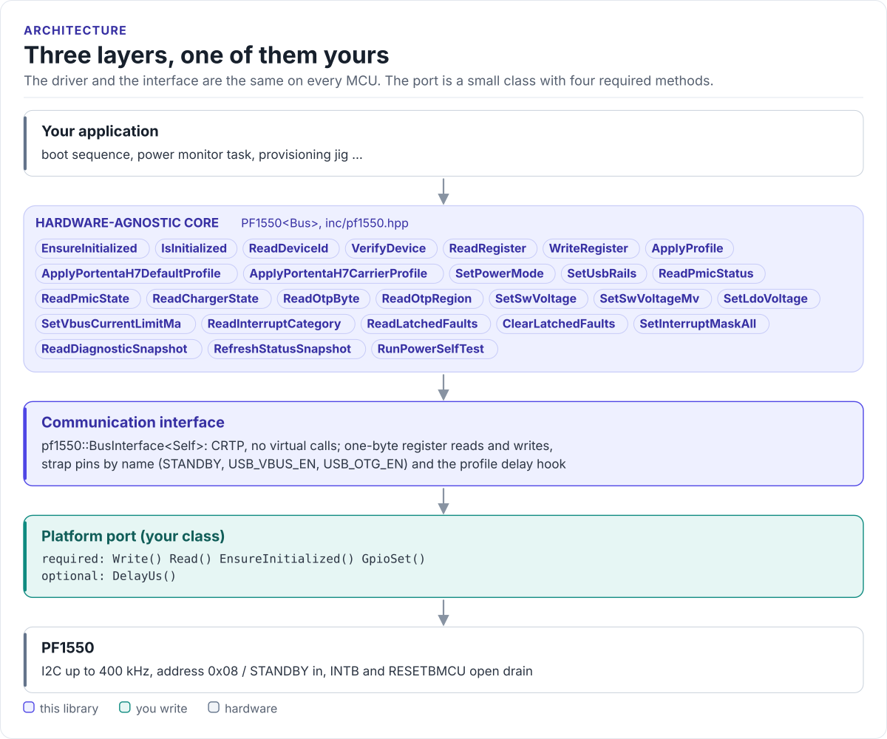

# PF1550 Driver

A header-only C++20 driver for the NXP PF1550 power management IC (three bucks, three LDOs, a Li-ion charger):
identify it, apply board power profiles, set rails and read rail state and faults, from any MCU with I2C.

[](https://github.com/hardfoc/hf-pf1550-driver/actions/workflows/ci-host-tests.yml)
[](https://github.com/hardfoc/hf-pf1550-driver/actions/workflows/esp32-examples-build-ci.yml)
[](https://hardfoc.github.io/hf-pf1550-driver/)
[](LICENSE)

**Documentation: <https://hardfoc.github.io/hf-pf1550-driver/>**

<!-- figure: driver-layers -->
<picture>
  <source media="(prefers-color-scheme: dark)" srcset="docs/diagrams/driver-layers.dark.svg">
  
</picture>
<!-- /figure -->

## In 30 seconds

Write a small port class for your MCU (register write, register read, bus init, strap pins;
[Porting](https://hardfoc.github.io/hf-pf1550-driver/latest/porting/)), then:

<!-- generated: quickstart-code -->
```cpp
#include <cstdio>

#include "pf1550.hpp"

int bring_up_pmic(MyI2c& bus) {
  pf1550::PF1550<MyI2c> pmic(&bus);              // 7-bit address 0x08

  if (!pmic.EnsureInitialized()) {               // 1. bus up, DEVICE_ID == 0x7C
    return -1;                                   // wiring, pull-ups or address
  }

  pf1550::PmicState state{};                     // 2. where is the state machine?
  if (!pmic.ReadPmicState(state) || state != pf1550::PmicState::Run) {
    return -2;
  }

  pf1550::DiagnosticSnapshot snap{};             // 3. SW1..LDO3: set point and enable
  if (!pmic.ReadDiagnosticSnapshot(snap)) {
    return -3;
  }
  for (size_t i = 0; i <= static_cast<size_t>(pf1550::RailId::Ldo3); ++i) {
    const auto id = static_cast<pf1550::RailId>(i);
    std::printf("%s %u mV %s\n", pf1550::RailName(id), snap.rails[i].set_voltage_mv,
                snap.rails[i].enabled_run ? "on" : "off");
  }
  return 0;
}
```
<!-- /generated -->

## What it does

- Finds the PMIC at 0x08 and checks DEVICE_ID (`EnsureInitialized()`).
- Applies a board profile, an ordered table of register writes with waits; the Arduino Portenta H7 default and
  carrier profiles are included.
- Sets SW and LDO set points and the VBUS input limit, and drives the STANDBY and USB strap pins.
- Reads state, charger state, a full diagnostic snapshot of every rail, latched faults and OTP.
- Decodes the data sheet's voltage, current-limit and state codes, checked at compile time.
- No heap, no exceptions, no RTOS, no virtual calls (the port is a CRTP class).

## Install

```bash
git submodule add https://github.com/hardfoc/hf-pf1550-driver.git external/hf-pf1550-driver
```

```cmake
add_subdirectory(external/hf-pf1550-driver)
target_link_libraries(my_app PRIVATE hf::pf1550)
```

ESP-IDF: use the component wrapper in [`examples/esp32/components/hf_pf1550`](examples/esp32/components/hf_pf1550/CMakeLists.txt).
Details: [Installation](https://hardfoc.github.io/hf-pf1550-driver/latest/installation/).

## Documentation

| | |
| --- | --- |
| [Quickstart](https://hardfoc.github.io/hf-pf1550-driver/latest/quickstart/) | Wire it, write the port, read the rails |
| [Hardware](https://hardfoc.github.io/hf-pf1550-driver/latest/hardware/) | Pins, bus settings, supplies, rails, parts |
| [Rails and OTP](https://hardfoc.github.io/hf-pf1550-driver/latest/rails-and-otp/) | Code tables, read-only registers, what OTP decides |
| [Portenta H7 profiles](https://hardfoc.github.io/hf-pf1550-driver/latest/portenta-h7/) | Every write of the built-in profiles |
| [API guide](https://hardfoc.github.io/hf-pf1550-driver/latest/api-guide/) | Identify, configure, read, handle faults |
| [API reference](https://hardfoc.github.io/hf-pf1550-driver/latest/api/) | Doxygen, every class and member |

The pages are in [`docs/`](docs/index.md). NXP's data sheet is not committed: `scripts/fetch_datasheet.sh` downloads
it into the git-ignored `_local_reference/`.

## Tests

```bash
cmake -S . -B build-host -DHF_PF1550_BUILD_TESTS=ON && cmake --build build-host && ctest --test-dir build-host
```

The host tests run the driver against a register model of the chip; the code on the documentation site is compiled
by the same build.

## License

GPL-3.0. See [LICENSE](LICENSE).
