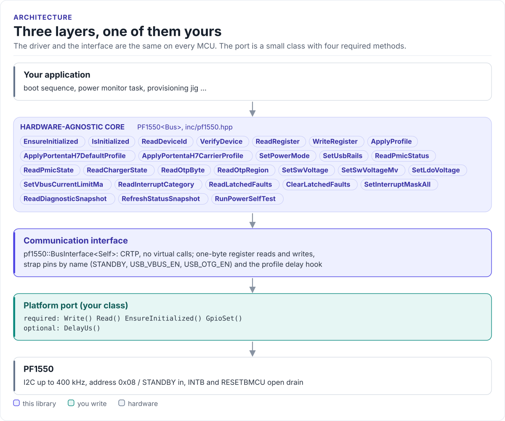
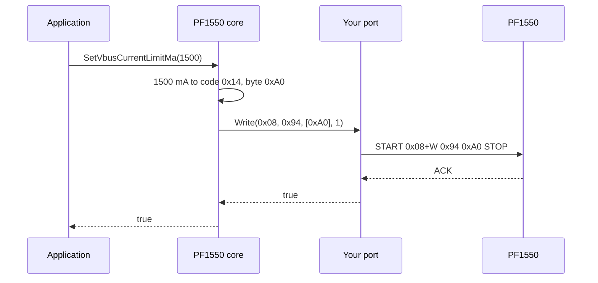

# Architecture

How the driver is put together: three layers, what each owns, and how one call reaches the chip.

<!-- figure: driver-layers -->
<picture>
  <source media="(prefers-color-scheme: dark)" srcset="diagrams/driver-layers.dark.svg">
  
</picture>
<!-- /figure -->

## The three layers

| Layer | Where | Depends on | You change it when |
| --- | --- | --- | --- |
| **Hardware-agnostic core**: `PF1550<Bus>` | [`inc/pf1550.hpp`](../inc/pf1550.hpp), [`src/pf1550.ipp`](../src/pf1550.ipp) | The interface's methods only | Never, for a new board |
| **Communication interface**: `BusInterface<Self>` | [`inc/pf1550_i2c_interface.hpp`](../inc/pf1550_i2c_interface.hpp) | Four methods of your port | Never |
| **Platform port**: your class | Your project | Your SDK | Once per MCU or board ([Porting](porting.md)) |

Board knowledge sits beside the core as data, not code: the register sequences in
[`pf1550_profiles.hpp`](../inc/pf1550_profiles.hpp) and the Portenta H7 fault-severity table in
[`pf1550_diagnostics.hpp`](../inc/pf1550_diagnostics.hpp). A board that is not a Portenta H7 passes its own table to
`ApplyProfile()` and classifies faults its own way.

Everything above the port is the same on ESP32, STM32, a Linux host or the unit-test model. That is how the
[host tests](testing.md) run the real driver code without hardware.

## How one call reaches the chip

A NACK makes the port return `false`; the core then sets `Error::I2cWrite` in its sticky error flags and returns
`false` to the application.

## Design choices

- **CRTP, not virtual functions.** The interface is a class template parameter. The compiler sees your port's
  methods directly and inlines them; the driver has no vtable and needs no RTTI. The driver type names the port:
  `PF1550<MyI2c>`.
- **No heap, no exceptions.** Every member is `noexcept`. Results come back as `bool` plus out-parameters; the
  cause of the last failures stays in `GetErrorFlags()` until you clear it.
- **Profiles are tables.** `profiles::RegisterWrite` is `{reg, value, delay_us}`. The core applies a table in
  order and stops at the first failed write, so a profile cannot leave a later rail half-configured without
  telling you.
- **Codes, not voltages.** Rail setters take the data sheet's register codes (`SwVoltageCode`, `LdoVoltageCode`),
  because which voltage a code means depends on OTP (see [Rails and OTP](rails-and-otp.md)). The
  `*ToMillivolts()` helpers decode them for display.
- **Header-only.** `pf1550.hpp` includes the template implementation `src/pf1550.ipp`; there is nothing to
  compile or link.

## Source map

| Path | Contents |
| --- | --- |
| `inc/pf1550.hpp` | `PF1550<Bus>`: identification, registers, profiles, rails, straps, OTP, interrupts, diagnostics |
| `src/pf1550.ipp` | Template implementation, included by the header |
| `inc/pf1550_i2c_interface.hpp` | `BusInterface<Self>`, `CtrlPin`, `GpioSignal`, `PowerMode` |
| `inc/pf1550_registers.hpp` | `Register` addresses, bit fields, voltage-code enums, OTP keys |
| `inc/pf1550_voltage_tables.hpp` | Code to millivolt and milliamp conversions, state decoders, compile-time checks |
| `inc/pf1550_profiles.hpp` | `RegisterWrite` and the two Portenta H7 profiles |
| `inc/pf1550_diagnostics.hpp` | `DiagnosticSnapshot`, `FaultFlags`, `SelfTestResult`, Portenta H7 severity table |
| `tests/` | Host unit tests and the compiled documentation snippets |
| `examples/esp32/` | ESP-IDF applications for the ESP32-C6 |
