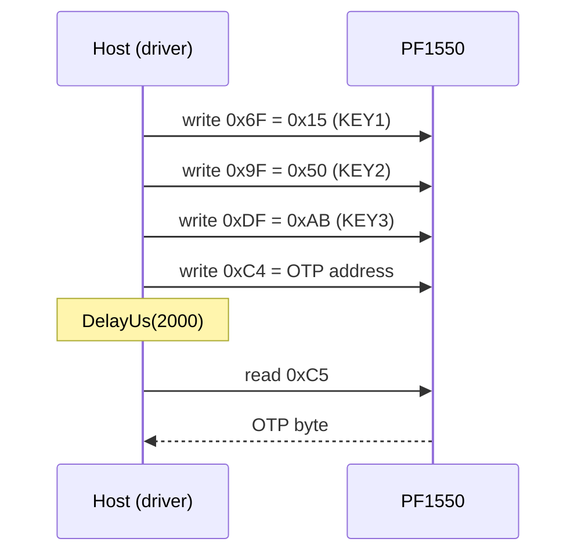

# Hardware

What to connect between your MCU and a PF1550, with which bus settings, and the electrical limits that matter to
the host.

All values here come from the [PF1550 data sheet](https://www.nxp.com/docs/en/data-sheet/PF1550.pdf) (Rev. 7,
29 September 2021). The PF1550 is the power supply of the board it sits on: when a value here disagrees with your
board's schematic, the schematic wins for pin connections and rail assignments.

## Host interface pins

| Pin | Signal | Direction and notes |
| --- | --- | --- |
| 2 | SDA | In / out, open drain; pull up to VDDIO |
| 3 | SCL | In; pull up to VDDIO |
| 4 | VDDIO | I/O supply, 1.7 V to 3.3 V: the logic level of every pin here |
| 7 | STANDBY | In; asserted means STANDBY, polarity from `STANDBYINV` |
| 9 | INTB | Out, open drain; low while an unmasked interrupt is pending |
| 10 | RESETBMCU | Out, open drain; reset for the application processor |
| 6 | PWRON | In; enable, level or edge sensitive (OTP) |
| 8 | ONKEY | In; push button, press and long-press interrupts |
| 1 | WDI | In; watchdog input from the processor |

Every logic pin's absolute maximum is 3.6 V, ONKEY's 4.8 V. Connect VDDOTP (pin 5) to ground in the application.

## Strap pins the driver drives

The driver addresses these by name (`pf1550::CtrlPin`) and by state (`GpioSignal::Active` / `Inactive`) through
your port's `GpioSet()`. Only STANDBY is a PF1550 pin; the USB enables are board signals that the Portenta H7
routes next to it.

| `CtrlPin` | Signal | Driver use |
| --- | --- | --- |
| `Standby` | PF1550 STANDBY; active = standby requested | `SetPowerMode()`: `Run` drives it inactive, `Standby` active |
| `UsbVbusEn` | Board VBUS switch enable; active = on | `SetUsbRails(vbus_en, otg_en)` |
| `UsbOtgEn` | Board OTG enable; active = on | `SetUsbRails(vbus_en, otg_en)` |
| `PmicInt` | PF1550 INTB (input) | Declared for ports; the driver does not read it |

With `STANDBYINV = 0` (the reset value) a high STANDBY pin means standby, so a port maps `Active` to high. Both
Portenta profiles write `PWRCTRL0 = 0x03`, which keeps `STANDBYINV = 0`.

## Bus settings

| Setting | Value |
| --- | --- |
| Bus | I2C, fast mode: up to 400 kHz |
| Address | 7-bit 0x08 (`kDefaultI2cAddress`); OTP can select 0x08 to 0x0F (`I2C_ADDR`, register 0x68) |
| Addressing | 7-bit only; no general call |
| Transfers | One register per transfer: write `[reg] [value]`, read `[reg]` then repeated START and one byte |
| Register pages | PMIC registers 0x00 to 0x7F; charger registers at 0x80 + offset (for example CHG_SNS, offset 0x07, at 0x87) |
| Edges | SCL and SDA rise and fall times must be over 20 ns; lower the master's drive strength if they are faster |

The driver reads OTP through an indirect window:
three unlock writes, a write of the OTP address to FMRADDR (0xC4), a 2 ms wait in the driver, then a read of
FMRDATA (0xC5).

## Power

| Supply | Range | Notes |
| --- | --- | --- |
| VBUSIN | 4.1 V to 6.0 V | USB or adapter; lockout at 6.5 V typ.; withstands 22 V |
| VSYS | 4.8 V max | Regulator input, charger output |
| VBATT | One Li-ion cell | Charge 3.5 V to 4.44 V, 100 mA to 1000 mA |
| VDDIO | 1.7 V to 3.3 V | Your MCU's I/O voltage |
| Ambient | −40 °C to 105 °C | MC34 parts; MC32 parts to 85 °C |

## Rails

| Rail | Rating | Range |
| --- | --- | --- |
| SW1, SW2 | 1.0 A | 0.6 V to 1.3875 V in 12.5 mV steps (DVS enabled), or eight set points from 1.1 V to 3.3 V (DVS disabled) |
| SW3 | 1.0 A | 1.8 V to 3.3 V in 100 mV steps |
| LDO1, LDO3 | 300 mA | 0.75 V to 1.5 V in 50 mV steps, 1.8 V to 3.3 V in 100 mV steps; load-switch mode |
| LDO2 | 400 mA | 1.8 V to 3.3 V in 100 mV steps |
| VSNVS | 2 mA | 3.0 V, RTC / backup supply |
| VREFDDR | 10 mA | 0.5 V to 0.9 V, DDR reference |

The buck current-limit setting (`SWx_ILIM`) is a typical limit of 1.0 A, 1.2 A, 1.5 A or 2.0 A. [Rails and
OTP](rails-and-otp.md) has the code tables and the rules for writing them.

## Parts

| Part | Temperature | OTP |
| --- | --- | --- |
| MC34PF1550A0EP | −40 °C to 105 °C | Not programmed: the host configures every rail (Arduino Portenta H7) |
| MC34PF1550A1EP to A9EP | −40 °C to 105 °C | Programmed for an i.MX processor and memory |
| MC32PF1550A0EP to A9EP | −40 °C to 85 °C | As above, consumer temperature range |

All parts report DEVICE_ID 0x7C (family `01111`, device `100`). OTP_FLAVOR (register 0x01) reads 0x00 on an
unprogrammed part.

## Reference documents

| Document | What it is for |
| --- | --- |
| [PF1550 data sheet](https://www.nxp.com/docs/en/data-sheet/PF1550.pdf) | Pins, electrical limits, state machine, OTP, register map (section 12) |
| [Register map](registers.md) | The registers the driver uses, with addresses and data-sheet tables |
| [`PF1550-i2c-register-reference.md`](https://github.com/hardfoc/hf-pf1550-driver/blob/main/docs/datasheet/PF1550-i2c-register-reference.md) | Plain-text extract of section 12, regenerated by `scripts/extract_register_reference.sh` |
