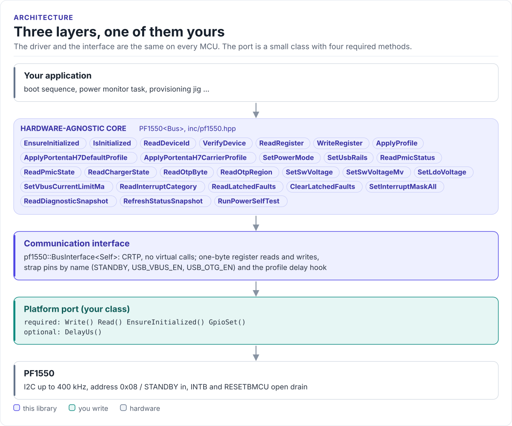

# Porting

Run the driver on a new MCU by writing one class: the bus interface for I2C and the strap pins.

The driver never calls your SDK directly. It calls four methods (and an optional fifth) on a class you derive from
`pf1550::BusInterface<Self>` (in [`inc/pf1550_i2c_interface.hpp`](../inc/pf1550_i2c_interface.hpp)). The base
class uses CRTP: the calls are resolved at compile time, so there are no virtual functions, no vtable and nothing to
allocate.

<!-- figure: driver-layers -->
<picture>
  <source media="(prefers-color-scheme: dark)" srcset="diagrams/driver-layers.dark.svg">
  
</picture>
<!-- /figure -->

## What you implement

| Method | Required | Contract |
| --- | :---: | --- |
| `EnsureInitialized()` | yes | Bring the bus up once; return `true` when it is ready. Called by the driver's `EnsureInitialized()` and before every profile |
| `Write(addr, reg, data, len)` | yes | `[addr+W] [reg] [data...] STOP`. The driver always sends `len = 1`. Return `false` on a NACK or timeout |
| `Read(addr, reg, data, len)` | yes | `[addr+W] [reg]`, repeated START, `[addr+R]`, `len` bytes, STOP. The driver always reads one byte |
| `GpioSet(pin, signal)` | yes | Drive `CtrlPin::Standby`, `UsbVbusEn` or `UsbOtgEn` to `Active` / `Inactive`; do nothing for a pin your board does not wire |
| `DelayUs(us)` | yes | Block for at least `us` microseconds (never less: on an RTOS, round the tick count up and add one tick). There is no default; a bus without it fails to compile with "PF1550 bus must provide DelayUs" |

`addr` is the 7-bit address; your SDK may want it shifted. The base class also provides `GpioSetActive(pin)` and
`GpioSetInactive(pin)`, which call your `GpioSet()`.

## The port

```cpp title="my_i2c.hpp"
--8<-- "tests/docs/my_i2c.hpp:port"
```

Rules the transfers must follow:

- **Return `false` for a NACK.** `EnsureInitialized()` reports `DeviceNotFound` from it, and a profile stops at
  the first failed write only if the port tells the truth.
- **Recover after a NACK.** The next transfer must work. Some controllers need a bus reset after a NACK; do it
  inside `Read()` / `Write()`.
- **Bounded time.** Use a timeout; a stuck bus must not block forever. Ten milliseconds is generous at 400 kHz.
- **At most 400 kHz.** The PF1550 implements fast mode. Keep SCL and SDA edges slower than 20 ns.

## Strap-pin levels

`GpioSet()` turns a logical state into a level. With the PF1550's default `STANDBYINV = 0`:

| `CtrlPin` | `Active` | `Inactive` |
| --- | --- | --- |
| `Standby` | High (standby) | Low (RUN) |
| `UsbVbusEn`, `UsbOtgEn` (Portenta) | High (enabled) | Low |

If your board inverts a signal, or a profile sets `STANDBYINV = 1`, swap the levels in `GpioSet()`; the driver
code stays the same.

## Reference implementation

The ESP32 examples use [`esp32_pf1550_bus.hpp`](../examples/esp32/main/esp32_pf1550_bus.hpp): an ESP-IDF
`i2c_master` port (400 kHz by default, internal pull-ups on, 1 s transfer timeout) with optional strap GPIOs from
Kconfig, and delays through `vTaskDelay()` (1 ms and longer) or `esp_rom_delay_us()`. Start from it for any ESP-IDF target.

## Through hf-core

In the HardFOC HAL, `hf-core` wraps this driver in `Pf1550Handler` (`handlers/pf1550/`, enabled with
`-DHF_CORE_ENABLE_PF1550=ON`). The handler builds the port from a `BaseI2c` and optional `BaseGpio` strap pins and
serialises calls with a mutex; use it there instead of writing a port.

## Check your port

1. Build it: the port on this page is compiled by the host CI from [`tests/docs/`](../tests/docs/my_i2c.hpp), with
   the driver instantiated over it.
2. Call `EnsureInitialized()`: it reads DEVICE_ID and must return `true`.
3. Read STATE_INFO with `ReadPmicState()`: `Run` on a powered board.
4. Take a `ReadDiagnosticSnapshot()` and compare the set points with a meter on each rail.
5. Read `GetErrorFlags()` after a few hundred calls: it should stay 0 on a healthy bus.

## Threads

The driver is not thread-safe. Give each PF1550 one owner task, or guard every call on a driver object (and its
port) with one mutex. A boot sequence and a monitor task that share one PMIC need that mutex.
